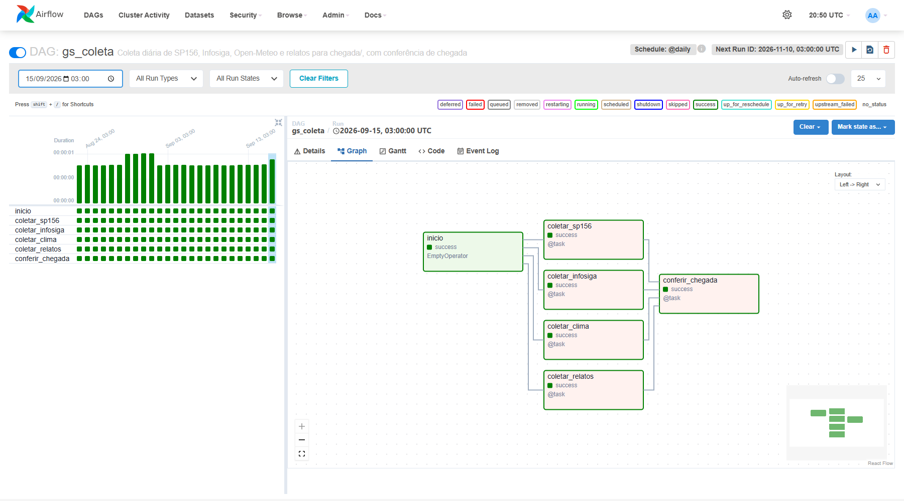
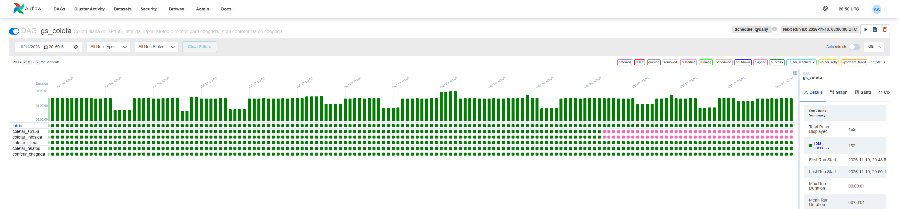

# Passo Seguro — Big Data & Data Integration

Ficha Técnica: [README do repositório principal](https://github.com/Passo-Seguro/passo-seguro#ficha-técnica)

## Integrantes
| Nome completo | RM |
|---|---|
| Guilherme Morais | 551981 |
| Júlia Marques | 98680 |
| Matheus Gusmão | 550826 |

## Repositórios do projeto
- Principal: [passo-seguro](https://github.com/Passo-Seguro/passo-seguro)
- GenAI: [passo-seguro-genai](https://github.com/Passo-Seguro/passo-seguro-genai) · Dados: [passo-seguro-dados](https://github.com/Passo-Seguro/passo-seguro-dados) · Visão: [passo-seguro-visao](https://github.com/Passo-Seguro/passo-seguro-visao) · RPA: [passo-seguro-rpa](https://github.com/Passo-Seguro/passo-seguro-rpa) · Robô: [passo-seguro-robo](https://github.com/Passo-Seguro/passo-seguro-robo)

## Pipeline de coleta (Airflow)

A DAG `gs_coleta` (`@daily`, `start_date` 2026-06-01, `catchup=True`) grava **um arquivo por fonte e por dia** em `chegada/<fonte>/`. O upload ao Databricks é manual, pela interface.

```
inicio >> [coletar_sp156, coletar_infosiga, coletar_clima, coletar_relatos] >> conferir_chegada
```

São 6 tarefas: `inicio` (`EmptyOperator`), as 4 coletas em paralelo e `conferir_chegada`, que confere se os arquivos chegaram. Na interface a coleta da Open-Meteo aparece como `coletar_clima` (`task_display_name`), mas o `task_id` continua `coletar_open_meteo`, o mesmo nome da fonte e da pasta; assim os logs e o histórico dos runs já executados ficam como estavam. Para usar na CLI, use `coletar_open_meteo`.





No Grid, `coletar_sp156` e `coletar_infosiga` ficam em rosa (`skipped`) de 01/10/2026 em diante. Não é falha: veja o primeiro item de "Como ler os dados".

| Fonte | Arquivo | Origem |
|---|---|---|
| `sp156` | `sp156_AAAA-MM-DD.csv` | Arquivo trimestral da Prefeitura (CKAN), só os 4 serviços de calçada (abaixo) |
| `infosiga` | `infosiga_AAAA-MM-DD.csv` | CSVs ou ZIP em `entrada_manual/infosiga/` (download manual); um sinistro por linha, só os de SAO PAULO com ao menos um pedestre (abaixo) |
| `open_meteo` | `open_meteo_AAAA-MM-DD.json` | Chuva horária num ponto na Praça da Sé |
| `relatos` | `relatos_AAAA-MM-DD.json` | `GET /relatos` da API; **simulado** enquanto a API não estiver no ar |

### Como ler os dados

- **SP156 e Infosiga são carregamentos retroativos, particionados pela data do registro.** O dia no nome do arquivo (`sp156_2026-07-15.csv`) é a data em que a solicitação foi **aberta** (SP156) ou em que o sinistro **aconteceu** (Infosiga), e não o dia em que a DAG rodou. As duas fontes publicam arquivos fechados, semanas depois; por isso o histórico desde 2026-06-01 é carregado de uma vez (catchup) e cada dia sai da carga mais recente disponível. **SP156 e Infosiga só publicam o trimestre depois que ele fecha**, então dia cujo trimestre ainda não saiu (hoje, de 01/10/2026 em diante: 40 dias em cada fonte) fica `skipped`, sem arquivo; não é erro. Quando o trimestre sair, limpe essas coletas (`airflow tasks clear gs_coleta -t '^coletar_(sp156|infosiga)$' -s 2026-10-01 -d -y`) para recoletar. Reexecutar um dia reescreve o mesmo arquivo. No Databricks, particione pelo dia do nome do arquivo.
- **Infosiga: uma linha por sinistro com pedestre.** Entram os sinistros do município `SAO PAULO` com ao menos uma vítima `tipo_de_vitima = 'PEDESTRE'` (arquivo `pessoas`, ligado por `pessoas.id_sinistro` → `sinistros.id_sinistro`). Colunas, separadas por `;`, em UTF-8 como o SP156: `id_sinistro`, `data_sinistro`, `hora`, `municipio`, `logradouro`, `latitude`, `longitude`, `qtd_pedestres`, `qtd_pedestres_feridos` (gravidade `GRAVE` ou `LEVE`), `qtd_pedestres_mortos` (`FATAL`). Pedestres `ILESO` ou `NAO DISPONIVEL` contam só em `qtd_pedestres`. Não há veículos nem dado individual de pessoa (idade, sexo etc.). `latitude` e `longitude` ficam **como vêm, com vírgula decimal** (`-23,5019`), e sinistros sem coordenada (cerca de 8%) **são mantidos** com os dois campos vazios: converter e tratar na Prata. Dia em que a fonte tem sinistros mas nenhum com pedestre gera arquivo só com o cabeçalho.
- **SP156 filtra por Serviço, não por Assunto.** Em 05/2026 a Prefeitura passou os mesmos serviços de calçada de "Calçadas, guias e postes" para "Fiação e Postes", então o Assunto não serve de filtro. A constante `SERVICOS_CALCADA` (`dags/gs_coleta_lib/sp156.py`) tem exatamente: *Calçada pública - solicitar manutenção*; *Calçada particular - denunciar calçada danificada ou inexistente*; *Acessibilidade - solicitar avaliação de obstáculo na calçada*; *Guias, sarjetas e sarjetões - solicitar manutenção*. Tapa-buraco (asfalto) e poda de árvore ficam de fora de propósito. O trimestre é lido do XLSX (datas tipadas) e convertido ao mesmo CSV do 2º TRI (`;`, `DD/MM/AAAA`); o arquivo fica em cache no volume `airflow-cache` e não é baixado de novo (para reprocessar um trimestre, apague-o de lá).
- **Relatos são simulados até a API estar no ar.** Com `PASSO_SEGURO_API_URL` vazia, a DAG gera relatos fictícios e determinísticos nas áreas-piloto (Sé e Pinheiros), todos com `"simulado": true` e `"origem": "mock"` no arquivo. Não use para análise real. Quando a API subir, preencha `PASSO_SEGURO_API_URL` e `PASSO_SEGURO_API_TOKEN` e limpe `coletar_relatos` (`airflow tasks clear gs_coleta -t '^coletar_relatos$' -d -y`; o `-d` refaz também a conferência) para recoletar o histórico com `"origem": "api"`.
- **O clima usa um único ponto, na Praça da Sé** (lat -23,5505, lon -46,6333), para representar a cidade inteira; a chuva varia entre zonas. Vem do arquivo histórico da Open-Meteo, e dos dias mais recentes (ainda sem reanálise) vem da previsão; o campo `coleta.api` do JSON diz qual API respondeu.

### Conferência de chegada (`conferir_chegada`)

Roda depois das 4 coletas, com `trigger_rule=none_failed_min_one_success` (nenhuma coleta falhou e ao menos uma gravou; coleta `skipped` não a impede). Para o dia do run, ela confere:

- coleta em `success`: existe `chegada/<fonte>/<fonte>_AAAA-MM-DD.<ext>` e o arquivo não está vazio (0 bytes). CSV só com cabeçalho (dia do Infosiga sem sinistro com pedestre) é válido e sai como aviso no log;
- coleta em `skipped`: não há arquivo, e o log traz o motivo (lido do log da coleta, porque o Airflow não o guarda no banco);
- **falha** se uma coleta `success` não deixou arquivo, se o estado for inesperado ou se nenhuma fonte gravou. A falha não tem nova tentativa e dispara o mesmo alerta do Discord das outras tarefas (`on_failure_callback` da DAG).

O log de cada run lista uma linha por fonte (`[CHEGOU]` ou `[SKIPPED] ... Motivo: ...`) e um resumo. A lógica está em `dags/gs_coleta_lib/conferir.py`, separada da DAG para ser testável sem o Airflow.

Limite conhecido: com essa trigger rule, se **todas** as coletas ficarem `skipped`, a própria `conferir_chegada` fica `skipped` em vez de falhar (hoje não acontece: Open-Meteo e relatos gravam todo dia). Para falhar nesse caso também, troque para `TriggerRule.NONE_FAILED`.

**Runs antigos.** `inicio` e `conferir_chegada` foram acrescentadas aos 162 runs já executados (01/06 a 09/11) **sem regravar nenhum arquivo de `chegada/`**. `airflow tasks clear` só limpa tarefas que já existem no banco, e essas duas não existiam nos runs antigos; por isso cada run foi recolocado na fila (`queued`). O scheduler então criou só as tarefas que faltavam e executou só elas, e as `coletar_*`, já em `success`/`skipped`, não foram reexecutadas. Conferido depois: hash e mtime dos 568 arquivos de `chegada/` iguais aos de antes, e as 648 tarefas `coletar_*` com estado, início, fim e tentativas intactos. Efeito colateral: a data de início e a duração de cada run, na interface, passam a ser as da conferência (10/11/2026, cerca de 1 s), não as da coleta original.

### Subir o Airflow

```bash
cp .env.example .env              # e preencha AIRFLOW_FERNET_KEY
docker compose build              # imagem do Airflow com openpyxl (Dockerfile)
docker compose up airflow-init    # uma vez
docker compose up -d              # http://localhost:8080 (admin/admin, só em 127.0.0.1)

docker compose exec airflow-scheduler airflow variables set ALERTA_WEBHOOK_URL '<webhook do Discord>'
docker compose exec airflow-scheduler airflow variables set PASSO_SEGURO_API_URL ''
docker compose exec airflow-scheduler airflow dags unpause gs_coleta   # catchup desde 2026-06-01
```

Falha de qualquer tarefa (após as tentativas), inclusive `conferir_chegada`, posta um alerta no webhook. Para testar: `airflow variables set FORCAR_FALHA_FONTE relatos`, dispare a DAG e depois `airflow variables delete FORCAR_FALHA_FONTE`.

## Databricks

Camada Bronze do Medallion no Databricks Free Edition (catálogo `workspace`). A CLI usa o profile `gs` (`databricks ... --profile gs`).

### Schema e Volumes

```bash
databricks schemas create gs workspace --profile gs
databricks volumes create workspace gs chegada MANAGED --profile gs   # arquivos coletados
databricks volumes create workspace gs privado MANAGED --profile gs   # segredos (sal, usado só na Ouro)
databricks volumes create workspace gs export MANAGED --profile gs    # painel.json da Ouro (consumido pela API)
for p in sp156 infosiga open_meteo relatos geo; do
  databricks fs mkdir dbfs:/Volumes/workspace/gs/chegada/$p --profile gs
done
```

Se já existirem, nada muda. O Auto Loader cria sozinho `chegada/_controle/` (schemas e checkpoints); não mexa nessa pasta.

### Sal

Fica em `/Volumes/workspace/gs/privado/sal.txt` (64 caracteres hex, gerado com `secrets.token_hex(32)`). **O valor não está no repositório nem em qualquer cópia local.** Ele é usado **só na Ouro**, para derivar o id do cidadão dos relatos; a Prata não o lê. Não o regenere depois da Ouro: trocar o sal muda todos os hashes derivados dele.

### Ordem de upload dos lotes

Os arquivos de `chegada/` **não** vão para o Git e sobem manualmente, pela interface (Catalog → `workspace.gs.chegada` → pasta da fonte → *Upload to this volume*), mantendo a pasta de cada fonte e o nome do arquivo.

1. Suba o **lote 1** (os arquivos mais antigos, nas pastas de cada fonte) e rode a Bronze (abaixo). Tire print da tabela de contagem do fim do notebook.
2. Suba o **lote 2** (o restante, em ordem de data) e rode a Bronze de novo. Tire print: só as linhas do lote 2 entram.
3. Rode a Bronze **mais uma vez, sem subir nada**. Tire print: os números não mudam (o checkpoint do Auto Loader já tem esses arquivos).

### Rodar a Bronze

O notebook fonte está em [`databricks/01_bronze.py`](databricks/01_bronze.py) e fica no workspace em `/Users/<seu e-mail>/passo-seguro/01_bronze`. Para atualizar a cópia do workspace depois de editar o arquivo:

```bash
databricks workspace import "/Users/<seu e-mail>/passo-seguro/01_bronze" \
  --file databricks/01_bronze.py --format SOURCE --language PYTHON --overwrite --profile gs
```

No Git Bash (Windows), prefixe com `MSYS_NO_PATHCONV=1` para o `/Users/...` não ser reescrito.

Abra o notebook, conecte ao compute serverless e use **Run all**. Ele lê cada pasta com Auto Loader e grava `workspace.gs.bronze_sp156`, `bronze_infosiga`, `bronze_open_meteo` e `bronze_relatos`, sempre em texto e com as colunas `arquivo_origem` e `carregado_em`. Notas:

- Reexecutar não duplica: o checkpoint de cada fonte (`chegada/_controle/checkpoint_<fonte>`) guarda os arquivos já lidos.
- Os nomes das colunas dos CSVs são normalizados (`Data de Finalização` → `data_de_finalizacao`); os valores não.
- Arquivo só com cabeçalho (ex.: `infosiga_2026-09-10.csv`) é lido sem erro, mas não gera linha, então não conta em `arquivos distintos`.
- Em `open_meteo` e `relatos` cada arquivo é uma linha; `hourly` e `itens` seguem aninhados até a Prata.
- Para recomeçar uma fonte do zero: apague a tabela e as pastas `schema_<fonte>` e `checkpoint_<fonte>` em `_controle/`.

## Prata

O notebook [`databricks/02_prata.py`](databricks/02_prata.py) lê a Bronze **inteira** a cada execução, tipa e limpa, deduplica pela chave e grava por `MERGE` em `workspace.gs.prata_sp156`, `prata_infosiga`, `prata_open_meteo` e `prata_relatos`. O que uma regra de qualidade barra não entra nessas tabelas e vai para `workspace.gs.prata_rejeitados` (`fonte`, `chave`, `regra`, `valor`, `detalhe`, `carregado_em`). Importe e rode como a Bronze (`/Users/<seu e-mail>/passo-seguro/02_prata`, *Run all*). Depois de subir o lote 2, basta rodar de novo.

Reexecutar não duplica: os aceitos entram por `MERGE` na chave e os barrados por `MERGE` em `(fonte, chave, regra)`. O fuso da sessão é `America/Sao_Paulo`.

### Chaves

| Tabela | Chave | Observação |
|---|---|---|
| `prata_sp156` | `id_solicitacao` | **A fonte não traz protocolo** (`numero` é o número do endereço). A chave é o SHA-256 dos campos que não mudam com o tempo (abertura, canal, tema, assunto, serviço, órgão, logradouro, número, CEP, coordenadas, prefeitura, distrito) mais um contador para linhas idênticas. `status` e `data_de_finalizacao` ficam fora, para a solicitação ser atualizada quando for finalizada |
| `prata_infosiga` | `id_sinistro` | |
| `prata_open_meteo` | `data_hora` | uma linha por hora; `cidade = 'Sao Paulo'` |
| `prata_relatos` | `id` | `simulado` e `origem` preservados |

Cada lote é deduplicado pela chave antes do `MERGE`, ficando o registro de `carregado_em` mais recente.

### Tratamento

- **SP156:** datas `DD/MM/AAAA` → `date` (`data_abertura`, `data_finalizacao`); lat/lon → `double`; `cep` só com 8 dígitos, senão nulo (`03.711000` → `03711000`; CEP de 5 ou 3 dígitos vira nulo); textos com `trim`; `categoria` = `calcada` (3 serviços de calçada e acessibilidade) ou `guia_sarjeta`; `status` padronizado (`status_original` é mantido).
- **Infosiga:** `data_sinistro` → `date`; `hora` em texto `HH:mm` e `data_hora_sinistro` em `timestamp`; lat/lon com vírgula → `double`; contagens → `int`; `tem_coordenada` (bool). **Sinistro sem coordenada não é barrado**: fica com `tem_coordenada = false`.
- **Open-Meteo:** `from_json` em `hourly` + `arrays_zip` + `explode`: `data_hora`, `cidade` e `precipitacao_mm`. A DAG só coleta `precipitation`, então a tabela não tem temperatura.
- **Relatos:** `from_json` em `itens` + `explode`, um relato por linha; a classe do relato é o campo `categoria`.

### Status do SP156

| Na fonte | Na Prata |
|---|---|
| Finalizada | `finalizada` |
| Cancelada | `cancelada` (status próprio; a fonte não tem "Indeferida") |
| Aberto, Em Andamento | `em_aberto` |

Valor novo fora dessa tabela fica nulo e o notebook avisa; acrescente em `MAPA_STATUS`.

### Regras de qualidade

| Regra | Barra quando | Fontes |
|---|---|---|
| `coordenada_fora_do_municipio` | há coordenada e ela está fora de lat -24,01 a -23,35 / lon -46,83 a -46,36 | sp156, infosiga, relatos |
| `data_no_futuro` | a data do registro (abertura, sinistro, hora, `criado_em`) é posterior ao momento da execução | todas |
| `categoria_ausente_ou_fora_da_lista` | relato com `categoria` nula ou fora de buraco / piso_danificado / obstaculo / veiculo_na_calcada; SP156 com serviço nulo ou fora de `SERVICOS_CALCADA` | relatos, sp156 |

Sem coordenada o registro **não** é barrado. `SERVICOS_CALCADA` existe em dois lugares, na DAG (`dags/gs_coleta_lib/sp156.py`) e no notebook `02_prata.py` (que não enxerga o repositório); **as duas listas precisam ficar iguais**. Se um registro deixa de falhar numa regra (ex.: data que era futura), o `MERGE` o tira de `prata_rejeitados`, então ele nunca fica aceito e barrado ao mesmo tempo.

### Linhas idênticas no SP156

Como a fonte não traz protocolo, não há como saber se duas linhas idênticas são a mesma solicitação duplicada ou dois pedidos diferentes. No lote 1, **455 das 10.667 linhas repetem todos os campos** de outra linha (mesmo dia de abertura, serviço, endereço, coordenadas, status etc.), em 10.212 combinações distintas. A Prata **mantém todas**: o mais provável é que sejam cidadãos diferentes pedindo o mesmo reparo no mesmo ponto, e colapsá-las subcontaria a demanda (~4%). Cada repetida ganha um contador (1, 2, 3...) na chave, então continuam linhas distintas e o `MERGE` segue idempotente. Para tratá-las como duplicata, basta tirar o contador de `id_solicitacao` no notebook.

### Dado pessoal: número e CEP do SP156

`numero` e `cep` (endereço exato de quem pediu) ficam **só na Prata**, que é a camada interna. Eles **saem da Ouro**; a Ouro não os expõe. `logradouro` também fica só na Prata, e as coordenadas só seguem para a Ouro arredondadas (seção Ouro).

### Resultado esperado com o lote 1 (até 31/08/2026)

Conferido por script local sobre `chegada/`, sem usar o notebook:

| Fonte | Aceitos | Barrados |
|---|---|---|
| sp156 | 10.666 | 1 `coordenada_fora_do_municipio` (lat/lon = 0) |
| infosiga | 926 (855 com coordenada, 71 sem) | 0 |
| open_meteo | 2.208 | 0 |
| relatos | 1.640 | 94 `categoria_ausente_ou_fora_da_lista` (categoria nula) |

Status do SP156 aceito: 5.882 `em_aberto`, 4.773 `finalizada`, 11 `cancelada`. `data_no_futuro` dá zero em todas as fontes, e `categoria_ausente_ou_fora_da_lista` só barra os 94 relatos sem categoria (nenhum tem categoria fora da lista). Nenhuma solicitação do SP156 tem `data_de_finalizacao` anterior à abertura, por isso não há regra para isso. Os 11 relatos inválidos de propósito estão em `amostras/relatos_mock.json`, que não vai para `chegada/`.

## Ouro

Camada final: modelo dimensional sem dado pessoal, uma view de prioridades por subprefeitura e o `painel.json` que a API serve em `GET /painel`. Ordem de execução: Bronze → Prata → **Ouro** (`03_ouro`) → consultas (`04_consultas`) → export (`05_export`). A Ouro é **derivada**: cada execução refaz todas as tabelas com `CREATE OR REPLACE TABLE` a partir da Prata, então depois do lote 2 basta rodar a Bronze, a Prata e a Ouro de novo.

| Arquivo | O que faz |
|---|---|
| [`scripts/preparar_geo.py`](scripts/preparar_geo.py) | baixa e simplifica os limites do GeoSampa (uma vez) |
| [`databricks/03_ouro.py`](databricks/03_ouro.py) | dimensões, fatos, view `vw_prioridades` e testes de LGPD |
| [`databricks/04_consultas.sql`](databricks/04_consultas.sql) | as 5 perguntas (Q4 em duas versões), só sobre a Ouro |
| [`databricks/05_export.py`](databricks/05_export.py) | grava `vw_prioridades` em `workspace.gs.export/painel.json` |
| [`scripts/conferir_ouro.py`](scripts/conferir_ouro.py) | refaz tudo localmente a partir de `chegada/` para conferir os números |
| [`docs/proposta-contrato-painel.md`](docs/proposta-contrato-painel.md) | campos a acrescentar em `GET /painel` no `openapi.yaml` |

### Limites geográficos (GeoSampa)

**Fonte:** GeoSampa / SMUL, Prefeitura de São Paulo, serviço WFS público (`http://wfs.geosampa.prefeitura.sp.gov.br/geoserver/geoportal/wfs`), camadas `geoportal:subprefeitura` (32 polígonos) e `geoportal:distrito_municipal` (96). **Baixado em 09/11/2026.** O serviço é aberto, sem login; se um dia recusar o acesso (401/403) o script para sem tentar contornar.

```bash
python scripts/preparar_geo.py     # grava entrada_manual/geo/{subprefeitura,distrito}.geojson (EPSG:4326, simplificados)
for n in subprefeitura distrito; do
  MSYS_NO_PATHCONV=1 databricks fs cp entrada_manual/geo/$n.geojson dbfs:/Volumes/workspace/gs/chegada/geo/$n.geojson --overwrite --profile gs
done
```

O script confere as contagens (32 e 96) e se as coordenadas estão em lat/lon dentro da caixa de São Paulo, e simplifica com tolerância de ~5,5 m (de 2,4 MB e 4,0 MB para 222 KB e 325 KB). **Os arquivos de `geo/` são referência, não lote**: a Bronze não os lê. A fonte tem um polígono de subprefeitura com auto-interseção, corrigido com `make_valid`.

**Nomes.** Os nomes do GeoSampa já vêm em maiúsculas e sem acento, e as 32 subprefeituras e os 96 distritos **coincidem exatamente** com os do SP156 depois de normalizar; por isso não há mapa de correção. As diferenças estão em 31 linhas do SP156 cuja `prefeitura_operacional` não é subprefeitura: `SUPERINTENDENCIA DAS USINAS DE ASFALTO` (19), nulo (7), `PREFEITURA REGIONAL NAO ENCONTRADA` (4) e `DEPARTAMENTO DE ESTRADAS DE RODAGEM` (1). Dois distritos também vêm nulos.

### Modelo dimensional

| Tabela | Uma linha por | Colunas |
|---|---|---|
| `dim_tempo` | data (do primeiro ao último dia de qualquer fonte) | `data`, `ano`, `mes`, `dia_semana`, `precipitacao_dia_mm`, `chuva_forte` |
| `dim_local` | par (subprefeitura, distrito): os 96 do GeoSampa + `NAO_IDENTIFICADO` | `local_id`, `subprefeitura`, `distrito` |
| `dim_categoria` | categoria de cada fonte | `categoria_id`, `categoria`, `grupo` |
| `fato_ocorrencia` | solicitação do SP156 e relato | `id_ocorrencia_hash`, `origem` (`sp156`/`relato`), `data`, `local_id`, `categoria_id`, `status`, `dias_ate_conclusao`, `simulado`, `latitude_arred`, `longitude_arred` |
| `fato_sinistro_pedestre` | sinistro do Infosiga com pedestre | `id_sinistro`, `data`, `local_id`, `qtd_pedestres`, `qtd_pedestres_feridos`, `qtd_pedestres_mortos` |

- **Local por ponto no polígono**, com `shapely` (`%pip` no notebook), para as **três** fontes. Ponto numa fresta de poucos metros entre polígonos (efeito da simplificação) recebe o polígono mais próximo, até ~50 m. Sem coordenada, ou fora de qualquer polígono, o local é `NAO_IDENTIFICADO` (ver "Registros sem local" abaixo). **O SP156 também usa o ponto**, e não a subprefeitura que ele declara: na comparação (lote 1) ela não é confiável. Além dos 31 valores acima, em 2,0% das linhas (209 de 10.635) diverge do ponto no polígono e em 196 contradiz o próprio distrito declarado. O declarado só serve de reserva quando o ponto não cai em polígono (hoje nunca).
- **Categoria:** `calcada` e `guia_sarjeta` (grupos de mesmo nome) no SP156; `buraco`, `piso_danificado`, `obstaculo` e `veiculo_na_calcada` nos relatos, todos no grupo `calcada`.
- **Status:** SP156 `em_aberto`, `finalizada`, `cancelada` (a fonte não tem "indeferida"). Relatos: `novo`, `revisao_humana`, `validado`, `encaminhado` → `em_aberto`; `resolvido` → `finalizada`; `rejeitado` → `indeferida`. `dias_ate_conclusao` só existe nas `finalizada` do SP156 (relatos não têm data de conclusão).
- **Chuva forte:** `precipitacao_dia_mm` é a soma das 24 horas do dia; `chuva_forte` = **≥ 10 mm/dia**; dia sem clima fica nulo. Os 10 mm são analíticos: com 50 mm/dia (alerta de chuva intensa do INMET) nenhum dia de jun-ago/2026 qualifica; com 10 mm há 4 dias no lote 1 (de 92) e 23 de 161 no clima até 08/11. A amostra do lote 1 é pequena, então a Q5 é indício.
- **As análises usam só `origem = 'sp156'`.** Os relatos são simulados e existem só nas áreas-piloto; ficam na `fato_ocorrencia` para o painel, mas nenhuma consulta nem o índice os usa, exceto `relatos_abertos`/`relatos_por_categoria` da view (que são do contrato).

### Registros sem local

No lote 1, 77 dos 926 sinistros ficam `NAO_IDENTIFICADO`, e uma solicitação do SP156 (de 10.666):

- **71 sinistros não têm coordenada** (o Infosiga não geolocaliza ~8%); a Prata os mantém com `tem_coordenada = false`.
- **6 sinistros e 1 solicitação do SP156 têm coordenada, mas ela não cai em nenhum polígono.** Eram 6 pontos distintos (dois sinistros dividem o mesmo ponto). **Não é efeito da simplificação:** conferi no GeoJSON original do GeoSampa, sem simplificar, e os mesmos pontos também ficam fora de todos os polígonos; a distância ao polígono mais próximo muda no máximo ~2 m entre o original e o simplificado. Os pontos estão **fora dos limites do município** na geometria oficial: 4 a menos de ~160 m (52, 76, 108 e 154 m, provável ponto de divisa ou imprecisão do GPS na via) e 2 bem além, a 1,3 km e a 5,5 km (coordenada provavelmente errada; o Infosiga informa município São Paulo).

A tolerância de ~50 m cobre só as frestas entre polígonos; não a ampliei, porque atribuir a uma subprefeitura um ponto que está fora do município seria chutar. Por isso a atribuição continua usando a geometria simplificada. Esses registros não se perdem: ficam na Ouro com `NAO_IDENTIFICADO` e só saem dos rankings por subprefeitura. O `03_ouro` lista os pontos (coordenada a 3 casas e distância ao polígono mais próximo).

### LGPD na Ouro

A Prata é a camada interna; a Ouro é a que vai para consulta, painel e API. Por isso a Ouro só leva o necessário para agregar por local, tempo e categoria:

| Dado | Tratamento na Ouro | Por quê |
|---|---|---|
| Número do endereço e CEP (SP156) | **não entram**; ficam só na Prata | Com a rua, identificam o imóvel e, portanto, o seu dono ou morador, que é quem fez o pedido |
| Coordenadas | arredondadas a 3 casas (~100 m): `latitude_arred`, `longitude_arred` | Basta para mapa e agregação; 100 m já não aponta uma casa. A subprefeitura e o distrito são atribuídos antes, com a coordenada completa |
| `id` do relato (e `id_solicitacao` do SP156) | `id_ocorrencia_hash = sha2(concat(sal, id), 256)`; o id original não entra | **Pseudonimização.** O `id` do relato é a chave que liga o registro à foto e à descrição guardadas no banco do app. Com o sal, que é secreto, quem tem acesso só à Ouro não consegue refazer essa ligação nem testar ids conhecidos. Sal em `/Volumes/workspace/gs/privado/sal.txt`, nunca exibido nem gravado. No SP156 o hash também impede refazer o endereço a partir do `id_solicitacao`, que é derivado dele |
| Texto livre e foto (`descricao`, `foto_url`), `logradouro` | **não entram** | O cidadão pode digitar telefone, CPF ou nome na descrição. Como a análise não usa o texto, ele fica na Prata em vez de ser mascarado na Ouro |

**Texto livre.** A `prata_relatos` tem `descricao` (texto digitado pelo cidadão; no lote 1 são só 4 frases simuladas, sem telefone, CPF ou e-mail) e `foto_url`. Nenhum dos dois, nem o `logradouro` do SP156, entra na Ouro: os `select` são explícitos e o teste de LGPD falha se aparecer uma coluna de texto que não esteja na lista permitida (só categorias e o hash).

**Não existe identificador do cidadão nos relatos hoje.** O contrato da API nunca devolve o `autor_id` (a API guarda só o hash), e o JSON coletado, a Bronze e a Prata não têm esse campo; o único identificador é o `id` do próprio relato, que é o que recebe o hash. **Se a API passar a enviar um identificador do cidadão, ele recebe o mesmo hash (`sha2(concat(sal, autor), 256)`) numa coluna própria**, nunca em `id_ocorrencia_hash`.

A última célula de `03_ouro` mostra 5 relatos com o hash e roda os testes: nenhum nome de coluna da Ouro é número, CEP, logradouro, id ou coordenada exata; nenhum id original, CEP ou descrição de relato aparece em coluna de texto; as únicas colunas de texto são as categóricas e o hash (nenhuma de texto livre, nenhum valor com mais de 64 caracteres); o hash dos relatos confere com a fórmula; as coordenadas têm até 3 casas. `id_sinistro` (id público do Infosiga) permanece.

### View `vw_prioridades` e o contrato de `GET /painel`

Uma linha por subprefeitura (as 32). Tem **duas famílias de colunas**: as do contrato (`PrioridadeSubprefeitura` no `openapi.yaml`, que o `05_export` grava) e as de análise (ainda fora do contrato).

| Coluna | Tipo | Contrato | Origem |
|---|---|---|---|
| `subprefeitura` | string | sim | GeoSampa |
| `prioridade` | `alta`/`media`/`baixa` | sim | faixa do `indice_prioridade` |
| `relatos_abertos` | int | sim | relatos `em_aberto` (simulados) |
| `relatos_por_categoria` | struct das 4 classes | sim | os mesmos relatos, por classe |
| `tempo_medio_ate_reparo_dias` | double ou nulo | sim | média de `dias_ate_conclusao` do SP156 `finalizada` |
| `atualizado_em` | timestamp | sim | `current_timestamp()`; no JSON vira ISO 8601 com fuso |
| `reclamacoes_calcada_sp156`, `reclamacoes_guia_sarjeta_sp156` | int | proposta | solicitações SP156 |
| `atropelamentos_pedestres`, `pedestres_mortos` | int | proposta | Infosiga (sinistros com pedestre; mortos) |
| `indice_prioridade` | double 0 a 1 | proposta | abaixo |
| `pct_em_aberto` | double | só na view | % das solicitações SP156 `em_aberto` |

- **`indice_prioridade`** = `(mm(atropelamentos_pedestres) + mm(reclamacoes_calcada_sp156)) / 2`, com `mm(x) = (x − mínimo) / (máximo − mínimo)` entre as 32 subprefeituras. Guia e sarjeta não entram no índice.
- **`prioridade`** é a posição relativa do índice (`PERCENT_RANK`): terço de cima `alta` (≥ 2/3), do meio `media` (≥ 1/3), de baixo `baixa`. É relativa: sempre há subprefeituras nas três faixas.
- **O contrato atual não tem os campos de análise** (`GET /painel` só fala de relatos). Eles ficam na view e **fora** do `painel.json`, porque a API responde `503 painel_invalido` se o arquivo sair do schema. Em `05_export.py` a lista está na constante `COLUNAS_EXTRAS`: quando o contrato for ampliado (proposta em [`docs/proposta-contrato-painel.md`](docs/proposta-contrato-painel.md)), mude **uma linha**, `INCLUIR_EXTRAS = True`. Os objetos do `painel.json` foram conferidos contra o schema `PrioridadeSubprefeitura` real do `openapi.yaml` (com e sem os extras).
- `relatos_abertos` e `relatos_por_categoria` são zero na maior parte da cidade enquanto os relatos forem simulados.

### Export

`05_export.py` lê a view, ordena por `indice_prioridade` decrescente (como o contrato pede), valida cada objeto contra o contrato e grava **um único** `/Volumes/workspace/gs/export/painel.json` (array de objetos, UTF-8, sem `_SUCCESS` nem `part-*`): o Python escreve direto no Volume. Se algum objeto sair do contrato, o notebook para antes de gravar.

### Importar os notebooks

```bash
for n in 03_ouro:PYTHON:py 04_consultas:SQL:sql 05_export:PYTHON:py; do
  IFS=: read nome lang ext <<< "$n"
  MSYS_NO_PATHCONV=1 databricks workspace import "/Users/<seu e-mail>/passo-seguro/$nome" \
    --file databricks/$nome.$ext --format SOURCE --language $lang --overwrite --profile gs
done
```

Rode no compute serverless, nesta ordem: `03_ouro` → `04_consultas` → `05_export` (Run all). O `03_ouro` instala o `shapely` com `%pip` e reinicia o Python na segunda célula.

### Resultado esperado com o lote 1 (até 31/08/2026)

Conferido por `python scripts/conferir_ouro.py` (Prata refeita a partir de `chegada/`, sem usar os notebooks; ela reproduz os números da Prata acima). `--corte AAAA-MM-DD` troca a data.

| Tabela | Linhas |
|---|---|
| `fato_ocorrencia` | 12.306 (10.666 `sp156` + 1.640 `relato`) |
| `fato_sinistro_pedestre` | 926 (77 sem local: 71 sem coordenada + 6 fora dos polígonos, ver abaixo) |
| `dim_tempo` | 92 (01/06 a 31/08) |
| `dim_categoria` | 6 |

**Status:** SP156 5.882 `em_aberto`, 4.773 `finalizada`, 11 `cancelada`; relatos 1.341 `em_aberto`, 212 `finalizada`, 87 `indeferida`. Apenas 1 solicitação do SP156 fica sem local.

**Q1** (calçada; entre parênteses calçada + guia e sarjeta e a posição): Santo Amaro 297 (1º; 426, 4º), Sé 282 (2º; 404, 11º), Vila Mariana 221 (3º; 407, 10º), Mooca 208 (4º; 408, 9º), Pinheiros 167 (5º; 424, 5º). Com guia e sarjeta lideram Itaquera (672), Pirituba-Jaraguá (551) e Jaçanã-Tremembé (516).

**Q2** (SP156 finalizadas): `calcada` 1.102, média 15,3 e mediana 7,0 dias; `guia_sarjeta` 3.671, média 20,4 e mediana 14,0.

**Q3:** SP156 44,7% finalizada, 0,0% indeferida, 0,1% cancelada, 55,1% em aberto; relatos 12,9% / 5,3% / 0,0% / 81,8%.

**Q4** (01/06 a 30/09; no lote 1 só até 31/08), no quartil superior (≥ P75) nas duas: só calçada, **Mooca** (65 atropelamentos, 208 reclamações), **Sé** (89, 282) e **Vila Mariana** (34, 221); calçada + guia e sarjeta, **Capela do Socorro** (39, 424), **M Boi Mirim** (39, 411) e **Pirituba-Jaraguá** (33, 551).

**Q5** (01/06 a 31/08): chuva forte 4 dias, 421 solicitações, média **105,3/dia**; demais 88 dias, 10.245, média **116,4/dia**.

**`vw_prioridades`:** 11 `alta`, 10 `media`, 11 `baixa`. Topo: Sé 0,972 (282 calçada, 89 atropelamentos, 2 mortos, 16,4 dias, 37,6% em aberto), Mooca 0,696, Santo Amaro 0,622, Vila Mariana 0,540, Pinheiros 0,405; a menor é Parelheiros (0,008). As 32 linhas saem do script.
